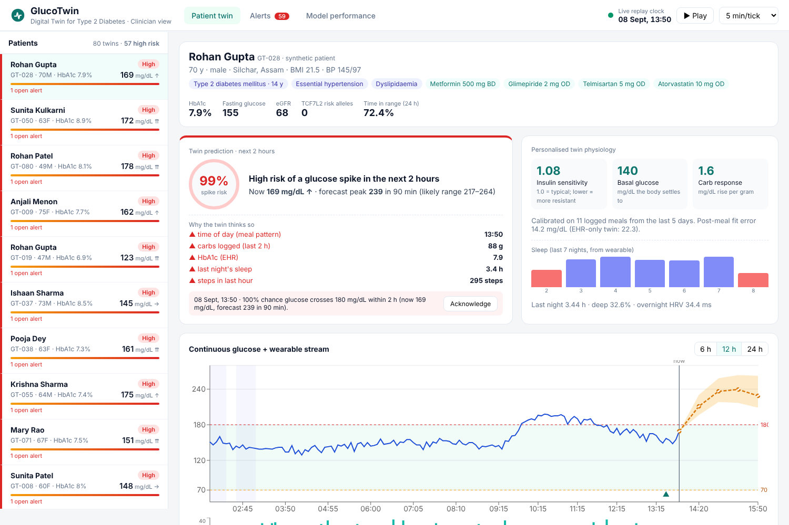
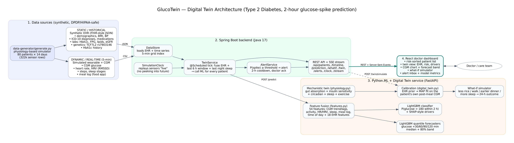
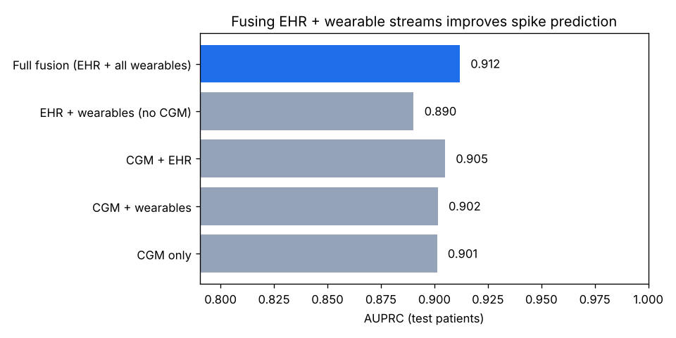

# GlucoTwin: a Digital Twin that warns about Type 2 Diabetes glucose spikes 2 hours early

> **Digital Twin Challenge 2026: Happiest Health, Reimagining & Reforming Healthcare in India Summit**
> Phase 1 submission: Prototype & Code



---

## 1. Team details

| | |
|---|---|
| **Team name** | Mavericks |
| **College / Incubator** | National Institute of Technology (NIT) Silchar, Assam |
| **Team leader** | Raushan Kumar, Electronics and Instrumentation Engineering, final year, raushan.nonhi@gmail.com |
| **Member 2** | Chaitanya Prasad, Electronics and Instrumentation Engineering, final year |

**Repository folder name (as required):** `Mavericks_NIT-Silchar`

---

## 2. Project title

**GlucoTwin: A personalised Digital Twin for Type 2 Diabetes that fuses EHR records with wearable/CGM streams to predict glucose spikes 2 hours in advance and lets doctors test lifestyle changes on a virtual patient.**

---

## 3. Problem statement and healthcare use case

### Problem statement
- India has an estimated **101 million people with diabetes** (ICMR-INDIAB study, *Lancet Diabetes & Endocrinology*, 2023), and most of them have Type 2 Diabetes (T2D).
- Care today is **reactive**. A patient sees the doctor every 3 months, HbA1c is checked, and the treatment is adjusted. Between visits, repeated **post-meal glucose spikes (> 180 mg/dL)** go unnoticed. These spikes drive long-term damage to the eyes, kidneys, nerves and heart.
- Indian lifestyles make spikes common: carbohydrate-heavy meals (rice/roti), late dinners, short sleep and low activity. The *Asian-Indian phenotype* also means higher insulin resistance at a lower BMI.
- Continuous Glucose Monitors (CGMs) and smartwatches now produce rich data, but **a doctor cannot read 288 readings per patient per day for hundreds of patients**.

### Healthcare use case
GlucoTwin builds a **virtual replica of each patient**:

1. **Static/historical stream:** the EHR (demographics, ICD-10 diagnoses, medications, HbA1c/FPG/lipids/eGFR, genetic marker *TCF7L2 rs7903146*, family history).
2. **Dynamic/real-time stream:** 5-minute data from a CGM and a consumer wearable (heart rate, HRV, steps, sleep stages), plus the patient's meal log.

The twin then:
- **Predicts** the probability that glucose will cross **180 mg/dL within the next 2 hours**, along with a 30/60/90/120-minute glucose forecast and an uncertainty band.
- **Explains** each prediction ("carbs logged in the last 2 h", "short sleep last night", "HbA1c 8.9%").
- **Alerts** the care team early enough to act. A call or app nudge such as "take a 15-minute walk after lunch" can prevent the spike.
- **Simulates what-if scenarios** on the patient's own calibrated physiology. Example: "If she eats 30% less rice at dinner and walks 20 minutes, how much does her time-in-range improve?"

**Who uses it:** endocrinologists, diabetologists, diabetes educators and remote-monitoring nurses in hospitals and telehealth programmes.

---

## 4. Solution overview



*(The PDF version is at [`docs/architecture.pdf`](docs/architecture.pdf).)*

| Layer | What it does | Tech |
|---|---|---|
| **Data generator** | Creates 80 synthetic Indian T2D patients × 14 days. Produces a FHIR-style EHR and 5-min CGM/HR/HRV/steps/sleep/meal-log streams from a physiology model. Labs are made consistent with each patient's simulated glucose (HbA1c from the ADAG formula). | Python, NumPy, pandas |
| **ML + twin service** | Feature fusion → LightGBM spike classifier + quantile forecasters. Mechanistic twin with per-patient calibration and a what-if simulator. | Python, FastAPI, LightGBM, SciPy |
| **Backend** | Loads both data streams and replays the sensors "live" on a simulation clock. Calls the ML service for every patient on every tick, raises and de-duplicates alerts, and serves the REST API plus a Server-Sent-Events stream. | Java 17, Spring Boot 3.3 |
| **Doctor dashboard** | Risk-sorted patient list, twin view (EHR + risk + drivers + CGM chart with forecast band), what-if simulator, alert inbox with acknowledgement notes, and a model-performance page. | React 18, Vite, Recharts |

### How the two streams are fused
For every 5-minute timestamp, `ml-service/twin/features.py` builds one row of **54 features**:

- **CGM (17):** current glucose, lags, 15/30/60-min trend, acceleration, 1-h/3-h mean, std, min and max, time above 180.
- **Wearable + app (16):** steps (30/60/180 min), heart rate above resting, HRV, asleep flag, carbs logged (1/2/3 h), time since the last meal, and the last night's sleep hours, deep sleep %, overnight HRV and resting HR, awakenings.
- **Time (3):** time of day (sin/cos), weekend.
- **EHR (18):** age, sex, BMI, waist, systolic BP, HbA1c, FPG, 2-h PPBG, eGFR, triglycerides, HDL, years since diagnosis, TCF7L2 risk alleles, family history, metformin, sulfonylurea, basal insulin, hypertension.

The **same function** runs in training and in live serving, so there is no train/serve mismatch.

### What makes it a *twin*, not just a classifier
`ml-service/twin/physiology.py` is a small, explainable glucose-dynamics model:

```
carbs → gut (2 compartments, time constant τ) → blood glucose G
dG/dt = cf·Ra − k·S_eff·(G − Gb_eff) − exercise uptake + stress release
S_eff = S × circadian dip (evening) × sleep-debt penalty × exercise afterglow
Gb_eff = Gb + dawn phenomenon (04:00–08:00)
```

The parameters are personalised:
1. A **prior from the EHR** (FPG → basal glucose; BMI, TCF7L2, HbA1c, disease duration → insulin sensitivity; weight → carb response).
2. **Calibration** (a MAP fit) on the patient's own post-meal CGM curves from the last 5 days.

The calibrated twin then powers the **what-if simulator**.

---

## 5. Technical stack and AI/ML model / framework details

| Component | Details |
|---|---|
| Spike classifier | LightGBM gradient-boosted trees (400 trees, 31 leaves, lr 0.05). Target: *glucose currently < 180 and crosses ≥ 180 within 120 min*. The alert threshold is chosen on validation patients for ≥ 85% sensitivity (0.44); ≥ 0.70 is HIGH. |
| Glucose forecaster | 12 LightGBM quantile regressors (10th/50th/90th percentile × 30/60/90/120 min), predicting change from current glucose. |
| Explainability | Per-prediction feature contributions from LightGBM's built-in TreeSHAP (`pred_contrib=True`), grouped into plain-language drivers. |
| Mechanistic twin | ODE model integrated at 5-min steps. Calibration uses Nelder-Mead MAP estimation (Huber loss + Gaussian prior around the EHR estimate). |
| Validation | **Patient-level split**: 48 train / 8 validation / 24 test patients. Test patients are never seen in training. |
| Backend | Java 17, Spring Boot 3.3 (Web, Scheduling, Actuator), RestClient, SseEmitter, Jackson |
| ML service | Python 3.10+, FastAPI, Pydantic v2, LightGBM 4, scikit-learn, SciPy, pandas |
| Frontend | React 18, Vite 5, Recharts 2 |

### Results (24 held-out test patients, 96,768 five-minute timestamps)

| Spike prediction | Value |
|---|---|
| AUROC | **0.950** |
| AUPRC (positive rate ≈ 0.35) | **0.912** |
| Sensitivity / precision at the alert threshold | 78% / 84% |
| Spike events caught by a continuous alert before onset | 91.8% |
| Spike events caught **≥ 30 min before onset** | **85.6%** |
| Median warning time | **100 min** |
| False alarms per patient-day | 2.15 |

| Glucose forecast | +30 min | +60 min | +90 min | +120 min |
|---|---|---|---|---|
| GlucoTwin RMSE (mg/dL) | **9.3** | **15.4** | **19.8** | **22.4** |
| "No change" baseline RMSE | 16.2 | 27.6 | 36.2 | 42.1 |

**Data-fusion ablation (AUPRC):**

| Inputs | AUPRC |
|---|---|
| CGM only | 0.901 |
| CGM + wearables | 0.902 |
| CGM + EHR | 0.905 |
| EHR + wearables (no CGM) | 0.890 |
| **Full fusion** | **0.912** |



**Twin calibration:** we calibrated on 5 days and tested on the next 2 days. The correlation of estimated insulin sensitivity with the hidden true value went from 0.52 (EHR prior) to **0.63** (calibrated). For basal glucose it went from 0.84 to **0.88**. Calibration lowered the post-meal error on held-out days for 67% of patients, but the median error barely changed (16.4 → 16.8 mg/dL).

### Honest limitations
- **All data is synthetic.** It was generated by the same family of physiology model the twin uses, so the absolute numbers above are optimistic. They show that the pipeline works. They are not clinical accuracy.
- Fusion gains over CGM-only are **small on this data**, because short-horizon glucose is dominated by recent CGM values and meal timing. Wearable and EHR features matter most when CGM data is missing (EHR + wearables still reach 0.890 AUPRC) and for personalisation (HbA1c and recent steps are among the top features by gain).
- Our post-meal fit improved for only two-thirds of patients, mainly because ~30% of meals are not logged and logged carb counts are noisy. Better meal detection is on the roadmap.
- This is a **decision-support prototype, not a medical device.**

### Roadmap
1. Validate on **real open data**: [CGMacros (PhysioNet)](https://physionet.org/content/cgmacros/) includes CGM, Fitbit and meal macros for people with T2D, prediabetes and healthy participants. We would also add **Synthea**-generated EHRs for larger cohorts.
2. Unlogged-meal detection from CGM rise patterns.
3. ABDM/FHIR integration (Ayushman Bharat Digital Mission) for real EHR pull, with consent per the DPDP Act.
4. Patient-side app nudges ("walk 15 min now") and closed-loop evaluation of whether alerts prevent spikes.

---

## 6. Demo video (15–20 minutes, unlisted YouTube)

**▶ Video link (unlisted YouTube):** https://youtu.be/CAtEV37w5I0
**Access:** this repository, the video and all linked files are public and need no extra permissions.

A recording script with timings (about 19 minutes) is in [`docs/video_script.md`](docs/video_script.md).

---

## 7. Architecture diagram and presentation

- Architecture diagram (PDF): [`docs/architecture.pdf`](docs/architecture.pdf)
- Presentation (PPTX): [`docs/GlucoTwin_Presentation.pptx`](docs/GlucoTwin_Presentation.pptx)
- Presentation (PDF): [`docs/GlucoTwin_Presentation.pdf`](docs/GlucoTwin_Presentation.pdf)

---

## 8. How to run

### Prerequisites
- Python 3.10+
- Java 17+ and Maven 3.9+
- Node.js 18+

### Option A: three terminals
```bash
# 1) Data + models (about 3 minutes; the data is already included, so you can skip generate.py)
cd ml-service
pip install -r requirements.txt
python ../data-generator/generate.py --patients 80 --days 14 --seed 42   # optional, regenerates data/
python train.py                                                          # trains models, writes models/metrics.json
uvicorn app:app --port 8000

# 2) Backend
cd backend
mvn spring-boot:run          # http://localhost:8080

# 3) Dashboard
cd frontend
npm install
npm run dev                  # open http://localhost:5173
```

### Option B: one command (Linux/macOS)
```bash
./start.sh
```

### Option C: Docker
```bash
docker compose up --build    # dashboard on http://localhost:5173
```

### Demo tips
- Use the **Play/Pause** button and the **speed selector** (5/15/30 simulated minutes per tick) in the top bar.
- To jump the replay clock to just before lunch on day 8:
  `curl -X POST localhost:8080/api/clock -H "Content-Type: application/json" -d '{"jump_to":"2026-09-08T12:30:00"}'`

### API reference (backend, port 8080)
| Method | Path | Purpose |
|---|---|---|
| GET | `/api/patients` | risk-sorted patient list |
| GET | `/api/patients/{id}` | EHR, summary, last 7 nights of sleep |
| GET | `/api/patients/{id}/timeline?hours=12` | sensor readings up to "now" |
| GET | `/api/patients/{id}/prediction` | spike probability, forecast, drivers |
| GET | `/api/patients/{id}/twin` | calibrated physiology parameters |
| POST | `/api/patients/{id}/whatif` | what-if simulation, e.g. `{"carb_change_pct":{"dinner":-30},"post_meal_walk_min":{"lunch":20}}` |
| GET / POST | `/api/alerts`, `/api/alerts/{id}/ack` | alert inbox and acknowledgement |
| GET / POST | `/api/clock` | replay clock state / control |
| GET | `/api/stream` | Server-Sent Events (ticks + new alerts) |
| GET | `/api/model` | evaluation metrics |

The ML service (port 8000) has interactive docs at `http://localhost:8000/docs`.

---

## 9. Repository structure
```
Mavericks_NIT-Silchar/
├── data/                      # synthetic EHR (JSON) + wearable time series (CSV) + hidden ground truth
├── data-generator/generate.py # synthetic cohort generator
├── ml-service/
│   ├── twin/physiology.py     # mechanistic glucose model
│   ├── twin/features.py       # EHR + wearable fusion
│   ├── twin/digital_twin.py   # calibration + what-if
│   ├── train.py               # training, ablation, evaluation, plots
│   ├── app.py                 # FastAPI service
│   └── models/                # trained models + metrics.json + plots/
├── backend/                   # Spring Boot (Java 17)
├── frontend/                  # React dashboard
├── docs/                      # architecture.pdf, presentation, video script, screenshots
├── docker-compose.yml, start.sh
└── LICENSE
```

---

## 10. Data and privacy (sandbox rules)
- **No real patient data is used.** Every patient, name, record and sensor reading is synthetic and is marked `"synthetic": true` in the EHR.
- The EHR follows a FHIR-style JSON structure with ICD-10 codes. The dataset can be replaced by Synthea output or anonymised clinical datasets (e.g. MIMIC-IV) through the same `ehr_vector()` mapping.
- `data/ground_truth_*` files hold the hidden meal events and true physiology parameters. They are used **only** for evaluation, never as model inputs.

---

## 11. Open-source license details
This project is released under the **MIT License**. See [`LICENSE`](LICENSE).

Third-party libraries keep their own licenses: Spring Boot (Apache-2.0), FastAPI (MIT), LightGBM (MIT), scikit-learn (BSD-3), SciPy (BSD-3), pandas (BSD-3), React (MIT), Recharts (MIT), Vite (MIT).
